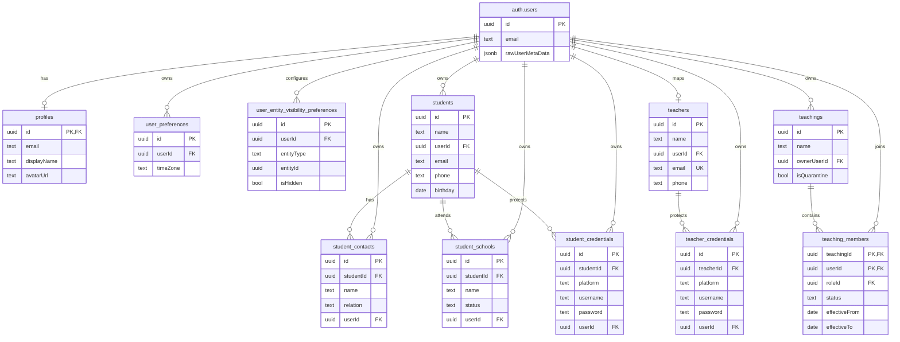
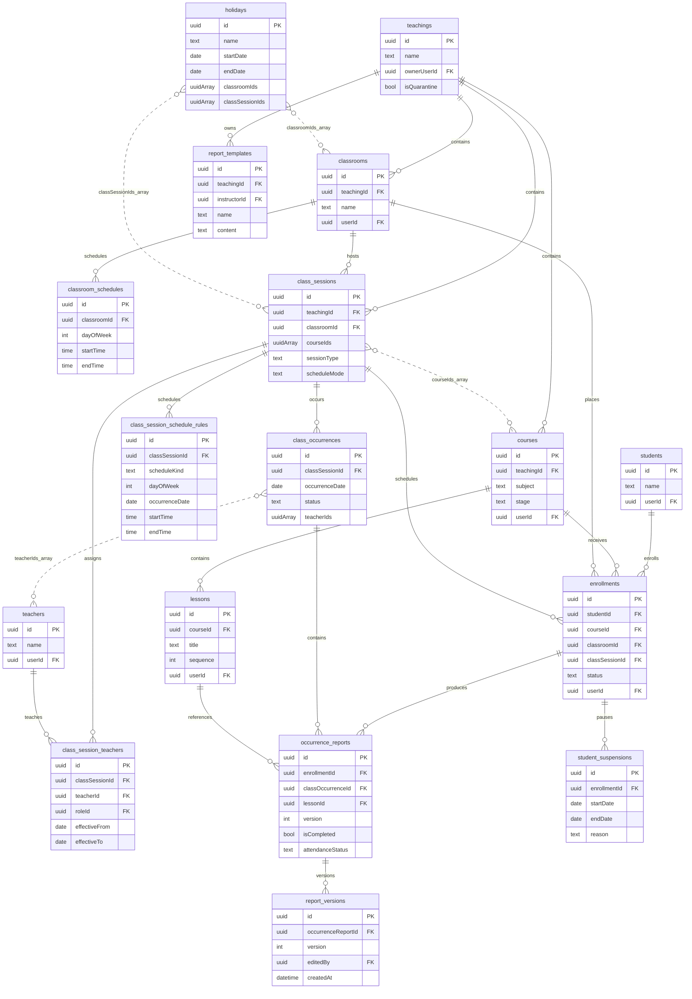

# EduLog Database ERD

本文件依目前 `supabase/migrations/1000001` 至 `1000041` 的實際 schema 整理。為保持可讀性，完整資料庫拆成三張 ERD；三張圖合起來涵蓋目前 repository 內的資料表。

## 1. Identity、people 與 teaching membership

## 2. Teaching、課務、排程與報表

## 3. RBAC、audit、idempotency、協作與轉課

```mermaid
erDiagram
    roles["roles"] {
        uuid id PK
        text name
        text domain
        bool isSystem
    }
    permissions["permissions"] {
        uuid id PK
        text key UK
        text domain
        text resource
        text action
    }
    rolePolicies["role_permission_policies"] {
        uuid id PK
        uuid roleId FK
        uuid permissionId FK
        text effect
        text scopeType
        uuid scopeId
    }
    userAssignments["user_role_assignments"] {
        uuid id PK
        uuid userId FK
        uuid roleId FK
        text scopeType
        uuid scopeId
        date effectiveFrom
    }
    roleInheritance["role_inheritance"] {
        uuid roleId PK, FK
        uuid parentRoleId PK, FK
        datetime createdAt
    }
    rbacEpoch["rbac_policy_epoch"] {
        bool singleton PK
        bigint epoch
        datetime updatedAt
    }
    auditEvents["audit_events"] {
        uuid id PK
        uuid actorUserId FK
        text action
        text domain
        text resource
        uuid resourceId
        uuid scopeId
        text outcome
    }
    idempotencyKeys["api_idempotency_keys"] {
        uuid userId PK, FK
        text idempotencyKey PK
        text method
        text route
        int responseStatus
        datetime expiresAt
    }
    rateLimitBuckets["api_rate_limit_buckets"] {
        text bucketKey PK
        datetime windowStartedAt
        int requestCount
        datetime resetAt
    }
    reportCollabDocs["report_collab_docs"] {
        uuid id PK
        uuid occurrenceReportId FK
        text snapshotBase64
        uuid lastUpdatedBy FK
    }
    documents["documents"] {
        uuid id PK
        text roomId UK
        text content
        uuid createdBy FK
        uuid updatedBy FK
    }
    copyTemplates["copy_templates"] {
        uuid id PK
        uuid userId FK
        text templateType
        text scopeType
        text scopeEntityId
    }
    transfers["single_lesson_transfers"] {
        uuid id PK
        uuid enrollmentId FK
        uuid sourceOccurrenceId FK
        uuid targetOccurrenceId FK
        uuid createdBy FK
    }
    transferArchives["single_lesson_transfer_report_archives"] {
        uuid id PK
        uuid transferId FK
        uuid sourceReportId
        jsonb sourceReport
        jsonb sourceVersions
    }
    authUsers["auth.users"] {
        uuid id PK
        text email
    }
    teachings["teachings"] {
        uuid id PK
        text name
    }
    reportTemplates["report_templates"] {
        uuid id PK
        uuid teachingId FK
    }
    reports["occurrence_reports"] {
        uuid id PK
        uuid enrollmentId FK
        uuid classOccurrenceId FK
    }
    enrollments["enrollments"] {
        uuid id PK
    }
    occurrences["class_occurrences"] {
        uuid id PK
        uuid classSessionId FK
    }
    transfers ||--o{ transferArchives : archives
    reports ||--o| reportCollabDocs : collaborates
    authUsers ||--o{ auditEvents : acts
    authUsers ||--o{ idempotencyKeys : deduplicates
    roles ||--o{ rolePolicies : grants
    permissions ||--o{ rolePolicies : describes
    roles ||--o{ userAssignments : assigned
    authUsers ||--o{ userAssignments : receives
    roles ||--o{ roleInheritance : inherits
    roles ||--o{ roleInheritance : parentOf
    teachings }o..o{ rolePolicies : scopeId
    teachings }o..o{ userAssignments : scopeId
    reports ||--o| reportCollabDocs : persists
    enrollments ||--o{ transfers : moves
    occurrences ||--o{ transfers : sourceOrTarget
    authUsers ||--o{ documents : edits
    authUsers ||--o{ copyTemplates : owns
    reportTemplates }o..o{ copyTemplates : scopeEntityId
```

## 關聯與安全註記

- 實線代表 migration 中有明確 foreign key；虛線代表陣列欄位或由 scope/RPC 解析的邏輯關聯。
- `teachings` 是主要 teaching scope root；`lessons`、`enrollments`、`occurrence_reports` 等資源需沿關聯解析 teaching，不能只依 `user_id` 判斷。
- `student_credentials`、`teacher_credentials`、contact 欄位屬敏感資料，API projection 不應與一般資料混出。
- `rbac_policy_epoch`、`role_inheritance`、`role_permission_policies` 與 `userAssignments` 共同形成 RBAC 快取失效與 deny-precedence 邏輯。
- `api_rate_limit_buckets` 不保存原始 IP；`api_idempotency_keys` 以使用者與 key 去重。
- `class_session.course_ids`、`class_occurrences.teacher_ids`、`holidays.classroom_ids/class_session_ids` 目前是 UUID 陣列，不是可由 PostgreSQL 自動維護的 FK。
